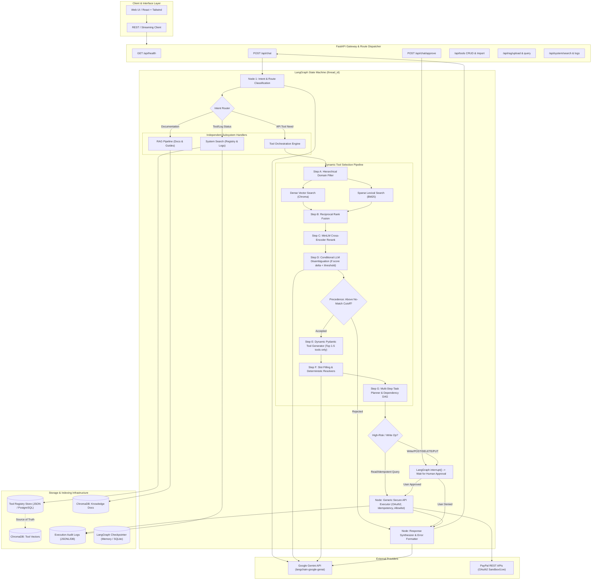

# NEXUS: Scalable Agentic Tool-Orchestration Platform
## System Architecture and Detailed Design Document (Milestone 0)

---

### Executive Summary
When large language models (LLMs) are provided with tens or hundreds of tool definitions in their prompt context, performance collapses due to:
1. **Context Saturation & Dilution:** Attention weights degrade over long system prompts, leading to tool confusion and hallucinated parameters.
2. **Context Window & Cost Explosion:** 500+ OpenAPI/Postman tool definitions easily consume 50,000–150,000 tokens per request, dramatically elevating latency and cost.
3. **Parameter Hallucination:** Even when the correct tool is picked from an oversized catalog, the LLM often mixes parameters across similar endpoints or invents missing fields.

**NEXUS** solves this problem through an end-to-end, multi-stage **Pre-Retrieval Routing & Dynamic Dynamic Injection Pipeline**. Instead of exposing the entire tool repository (50 to 5,000+ API tools) to the model, NEXUS:
- Employs a **hierarchical, hybrid retrieval architecture** combining domain classification, dense Chroma vector search over rich descriptions and synthetic user queries, and sparse lexical BM25 search.
- Fuses rankings with **Reciprocal Rank Fusion (RRF)**, re-ranks with a **MiniLM Cross-Encoder**, and applies **conditional LLM disambiguation** only when score margins are narrow.
- Dynamically generates **Pydantic schema constraints** for only the selected 1–5 candidate tools at runtime.
- Executes slot-filling deterministically where possible (date windows, currency, emails) and strictly schema-constrained via LLM structured outputs.
- Governs multi-step plans and human-in-the-loop approvals via a stateful **LangGraph** orchestration graph with persistent checkpointing.

---

### 1. Architecture Diagram & Request Lifecycle

#### 1.1 Architecture Diagram (Mermaid)



#### 1.2 Detailed Request Lifecycle

1. **Intake & Thread Context Initialization:**
   - The user query arrives at `POST /api/chat` with optional `thread_id` and `session_state`.
   - The state machine hydrates past conversation turns and session-sticky candidate tools from the persistent checkpointer.

2. **Intent Classification & Domain Routing:**
   - A deterministic classifier evaluates whether the prompt is a meta-inquiry about available tools/system status (`system_search`), a policy/documentation question (`rag_pipeline`), or an operational transaction (`tool_retrieval`).
   - If `tool_retrieval`, query understanding extracts the target domain service (`invoicing`, `payments`, `disputes`, `reporting`) to prune the tool search space.

3. **Hybrid Multi-Vector Retrieval:**
   - **Dense Retrieval:** Queries the persistent Chroma tool collection. The collection stores both structural metadata (name, endpoint, description, parameters) and 5–10 synthetic example user queries per tool generated during offline enrichment.
   - **Sparse Retrieval:** Executes a BM25 index over tokenized endpoint signatures, exact path segments (e.g., `v2/invoicing/invoices`), and parameter names.
   - **Rank Fusion:** Fuses both ranked lists via Reciprocal Rank Fusion:
     $$RRF\_Score(d) = \sum_{m \in \{dense, sparse\}} \frac{1}{60 + \text{rank}_m(d)}$$

4. **Multi-Stage Reranking:**
   - Top 10–15 candidates are passed to a local Cross-Encoder (`ms-marco-MiniLM-L-6-v2`) computing query-document cross-attention scores.
   - **Conditional LLM Disambiguation:** If the margin between the top two tools is below the ambiguity threshold ($\Delta < 0.12$), a fast LLM call is invoked with only the two candidate tool signatures to disambiguate intent.
   - **Precedence Rule:** Candidates below the absolute `no_match_threshold` are pruned. If no tools qualify, the pipeline safely terminates retrieval and requests clarification rather than forcing a low-confidence match.

5. **Dynamic LangChain Tool Generation & Schema-Constrained Slot Filling:**
   - Only the qualifying top 1–5 candidate tools are dynamically transformed into LangChain `StructuredTool` objects with runtime-generated Pydantic schemas.
   - Deterministic resolvers parse temporal references ("last month" $\to$ ISO 8601 start and end dates), numeric currency amounts, and email patterns.
   - Structured parameter filling runs against the validated Pydantic schema. If mandatory parameters are missing, the agent outputs a clarification prompt instead of hallucinating values.

6. **Multi-Step Dependency Planning & Human-in-the-Loop Approval:**
   - If the task requires chained operations (e.g., `create_invoice` followed by `send_invoice`), the agent establishes a DAG dependency mapping the output `invoice_id` to the downstream input.
   - Risk assessment checks the HTTP method and security flags. Mutating actions (POST, PUT, PATCH, DELETE) trigger a LangGraph `interrupt()`, storing the state and returning an approval challenge to the client.
   - Read actions (GET) proceed immediately.

7. **Generic Secure Execution:**
   - The executor resolves the endpoint definition strictly from the registry allowlist. The LLM never provides or alters the raw URL.
   - Automatic OAuth2 token acquisition and refresh for PayPal APIs.
   - Deterministic idempotency keys (`PayPal-Request-Id`) generated for all write operations.
   - Exponential backoff with jitter applied to transient failures (429, 503, timeouts); 401 triggers token refresh; non-idempotent 4xx/5xx are never replayed blindly.

8. **Response Generation & Audit Logging:**
   - Execution outputs are sanitized (stripping tokens and raw headers) and synthesized into a markdown response with structured trace metadata.
   - The execution is recorded in `execution_logs` with a unique `request_id`, status, and latency.

---

### 2. Agent Structure, Tool Selection, State Management, Scalability, and Error Handling

#### 2.1 Agent Structure
The agent is constructed as a deterministic directed acyclic state graph (LangGraph) with 6 core functional nodes:
- `node_route_intent`: Classifies user input into `TOOL`, `RAG`, `SYSTEM_SEARCH`, or `CLARIFICATION`.
- `node_retrieve_tools`: Executes hierarchical filtering, BM25 + dense Chroma search, RRF, Cross-Encoder rerank, and conditional disambiguation.
- `node_plan_and_fill`: Dynamically synthesizes Pydantic schemas, runs deterministic slot resolvers, and generates execution payload.
- `node_approval_gate`: Inspects tool risk levels; if high risk, pauses execution using `interrupt()`.
- `node_execute`: Generic HTTP executor with OAuth2 caching, idempotency header injection, and retry policies.
- `node_respond`: Formats user-facing markdown response and trace summary.

#### 2.2 Tool Selection & Routing
To avoid catastrophic degradation at scale, tool selection follows a 3-tier cascade:
1. **Tier 1 (Service/Category Routing):** Uses keyword & embedding centroid mapping to restrict search to target services (e.g., `invoicing`, `disputes`).
2. **Tier 2 (Dense + BM25 Hybrid Retrieval with Multi-Vector Ingestion):**
   - Each tool has an aggregate definition vector and individual vectors for each of its 5–10 synthetic example queries.
   - Queries match directly against natural language representations of user intent.
3. **Tier 3 (Cross-Encoder & Precision Filter):**
   - Cross-encoder reranks top 15 down to top 5.
   - Candidate validation strictly verifies returned tool IDs against the registry allowlist.

#### 2.3 State Management
- State is modeled in a typed Pydantic/TypedDict `NexusState`:
  ```python
  class NexusState(TypedDict):
      user_query: str
      thread_id: str
      intent: str
      service_filter: Optional[str]
      retrieved_tools: List[Dict[str, Any]]
      retrieval_scores: Dict[str, float]
      cross_encoder_scores: Dict[str, float]
      llm_confidence: Optional[float]
      execution_plan: List[Dict[str, Any]]
      pending_action: Optional[Dict[str, Any]]
      approval_granted: bool
      execution_results: List[Dict[str, Any]]
      session_sticky_tools: List[str]
      clarification_prompt: Optional[str]
      final_response: str
      error: Optional[str]
  ```
- LangGraph's persistent checkpointer (`MemorySaver` or `SqliteSaver`) preserves conversation history, pending approval states, and session-sticky candidate pools across multiple HTTP interactions.

#### 2.4 Scalability Architecture
- **In-Memory & Persistent Caching:** Reranker models and embeddings are loaded once at process initialization.
- **Hierarchical Partitioning:** High tool volumes (500 to 5,000) are partitioned by service namespace, ensuring vector search queries operate on sub-indexes of fewer than 200 candidates.
- **Incremental Indexing with SHA-256 Content Hashing:** Tools are only re-embedded when their normalized specification changes.

#### 2.5 Error Handling Architecture
- **Missing Required Parameters:** Triggers structured clarification requests without executing or guessing.
- **Pre-Execution Validation:** Parameter types, formats (ISO dates, UUIDs, currencies), and enum constraints are validated against Pydantic schemas before dispatch.
- **Network & Provider Resilience:** Structured error taxonomy categorizing failures into:
  - `AUTH_FAILURE` (401, invalid credentials)
  - `RATE_LIMIT` (429, retry after backoff)
  - `UNPROCESSABLE_ENTITY` (422, parameter mismatch)
  - `UPSTREAM_UNAVAILABLE` (502/503/504)
  - `NOT_CONFIGURED` (live execution skipped when credentials absent)

---

### 3. Framework Comparison Table

| Framework | Core Strengths | Critical Drawbacks | Suitability for NEXUS | Decision & Rationale |
| :--- | :--- | :--- | :--- | :--- |
| **LangGraph** | Explicit cyclical and stateful graph control; native `interrupt()` for human-in-the-loop; persistent state checkpointing; minimal abstraction overhead; first-class structured streaming. | Steeper learning curve than simple sequential chains; requires explicit state typing. | **Ideal (Chosen)** | **Selected.** Provides exact deterministic state transitions, interrupt-and-resume workflows for PayPal write approvals, and robust thread state persistence without hidden agent loops. |
| **LlamaIndex** | Excellent out-of-the-box RAG pipelines; extensive vector index abstractions. | Tool orchestration relies on agentic loops that struggle with multi-stage pre-retrieval routing; agent state transitions are less granular than a pure state graph. | Secondary (RAG only) | Not chosen for agent orchestration because dynamic schema generation and human approval checkpoints are much cleaner and more controllable in LangGraph. |
| **CrewAI** | Multi-agent role-playing abstractions; rapid prototyping of collaborative agents. | High LLM call count (5–10+ calls per step); high token overhead; non-deterministic tool attachment; lacks native fine-grained breakpoint/approval graphs. | Unsuitable | Rejected. High latency and token overhead directly oppose the goal of 2–3 LLM calls per request and strict dynamic tool isolation. |
| **DSPy** | Algorithmic prompt optimization and few-shot compilation; strong mathematical foundation. | Limited native support for complex operational state machines, human approval pauses, and production API execution lifecycle management. | Experimental | Rejected. Tool execution and stateful workflow resumption require explicit state engines rather than prompt compilers. |
| **From-Scratch (Custom)** | Absolute control over every byte and execution cycle; zero external abstraction weight. | Reinventing graph state machines, branching, checkpointing, and edge conditional evaluation increases maintenance cost and surface area for bugs. | High effort | Rejected. LangGraph already provides the battle-tested state machine engine; custom logic is applied where it matters: hybrid retrieval, RRF, and execution. |

---

### 4. Pre-Retrieval Routing vs. Agent-Invoked `search_tools` Meta-Tool

| Dimension | NEXUS Pre-Retrieval Routing (Chosen) | Agent-Invoked `search_tools` Meta-Tool |
| :--- | :--- | :--- |
| **LLM Call Overhead** | **1–2 Calls:** Retrieval is deterministic (BM25 + Vector + Cross-Encoder). LLM is only called once for slot filling and once for response synthesis (plus optional conditional disambiguation). | **3–5 Calls Minimum:** LLM must receive user prompt, call `search_tools`, receive search results in context, call the actual tool, and finally synthesize output. |
| **Context Pollution** | **Zero:** LLM never sees candidate tool catalogs until 1–5 qualified tools are retrieved. | **High:** Search results returned to the agent must be dumped into the conversational context, consuming token budget and diluting attention. |
| **Failure Modes** | Predictable: If retrieval misses, fall back to clarification or no-match threshold deterministically. | Compounded: Agent may formulate poor search queries, get partial results, loop indefinitely, or hallucinate tool names. |
| **Latency** | **Low (< 200ms retrieval overhead):** Hybrid retrieval runs in native C++/Python (Numpy, Chroma, BM25). | **High (> 1,500ms):** Multiple sequential LLM generation steps and tool dispatch cycles. |
| **Tool Dependency Modeling**| Direct: Graph planner deterministically inspects parameter schemas for dependencies (e.g. `invoice_id`). | Emergent: Relies on the agent to self-reflect and chain successive tool calls across turns. |

---

### 5. Scaling Analysis: 50 vs. 500 vs. 5,000 Tools

```mermaid
graph LR
    subgraph Scale50 ["50 Tools (Single Service / PayPal Invoicing)"]
        A1["Flat In-Memory BM25 + Single Chroma Collection"]
        A2["Direct Dense + Sparse RRF Search"]
        A3["All candidate vectors fit in RAM (< 10 MB)"]
    end

    subgraph Scale500 ["500 Tools (Multi-Service Enterprise Suite)"]
        B1["Hierarchical Service Partitioning"]
        B2["Two-tier routing: Service Classifier -> Sub-Collection"]
        B3["MiniLM Cross-Encoder top-20 rerank"]
    end

    subgraph Scale5000 ["5,000 Tools (Enterprise Ecosystem)"]
        C1["PostgreSQL + pgvector / Distributed HNSW"]
        C2["Multi-level taxonomy routing (Service -> Category -> Tool)"]
        C3["Tiered Vector Caching & Read Replicas"]
    end

    Scale50 --> Scale500 --> Scale5000
```



#### Detailed Breakdown & Bottleneck Evolution:

1. **At 50 Tools (Baseline):**
   - *Where it breaks:* Naive prompt injection (attaching all 50 tools directly to Gemini) already uses ~10k tokens and causes occasional parameter hallucinations.
   - *NEXUS Solution:* Single Chroma collection + in-memory BM25 index. Hybrid RRF retrieval finishes in < 25ms. Cross-encoder reranks top 10 in < 30ms.

2. **At 500 Tools:**
   - *Where it breaks:* Flat vector search across 500 tools with 5–10 synthetic query embeddings (3,500–5,000 vectors) begins to return semantic cross-talk (e.g. `create_invoice` vs `create_order` vs `create_payout`). BM25 corpus vocabulary becomes noisy.
   - *NEXUS Solution:* Service-level pre-routing. The query classifier routes to a specific service namespace (`invoicing`, `payments`, `disputes`), pruning 85% of irrelevant candidates before vector calculation.

3. **At 5,000 Tools:**
   - *Where it breaks:* In-memory Chroma SQLite storage experiences lock contention; loading 50,000 vector embeddings into memory on single-node processes causes memory pressure; BM25 RAM footprint increases.
   - *NEXUS Solution:*
     - Migrate registry and vector store to **PostgreSQL with `pgvector`** (HNSW index) partitioned by `service_id`.
     - Implement 3-tier routing: Intent $\to$ Service $\to$ Category $\to$ Hybrid Tool Retrieval.
     - Add an **LRU embedding and query result cache** for recurring queries.
     - Distribute Cross-Encoder inference to dedicated GPU worker pools or asynchronous batch inference endpoints.

---

### 6. Observability Choice & Trade-offs

#### Selected Strategy: Dual-Track Observability
1. **Lightweight Internal Request Tracing (Native, Zero Dependency):**
   - Every request is tagged with a UUID `request_id` and tracked through an internal `ExecutionLog` repository.
   - Captures stage-by-stage timings: Intent Classification $\to$ Dense/Sparse Retrieval $\to$ Rerank $\to$ Slot Fill $\to$ Execution $\to$ Total Latency.
   - Tracks exact prompt token counts, completion token counts, and candidate scores (BM25 score, dense cosine similarity, cross-encoder logit, LLM confidence).
   - Exposed directly to the frontend chat UI as an expandable **Execution Trace** inspector.

2. **LangSmith Integration (Optional via Environment Variables):**
   - Configured purely through `LANGCHAIN_TRACING_V2=true`, `LANGCHAIN_API_KEY`, and `LANGCHAIN_PROJECT`.
   - When keys are present, LangChain and LangGraph automatically dispatch background traces to the LangSmith cloud.
   - **Critical Design Requirement:** NEXUS operates 100% locally and functionally without LangSmith. If env vars are absent, all tracing falls back cleanly to the internal structured logger without performance degradation or error throwing.

---

### 7. Known Limitations & Verification Boundaries

1. **PayPal Sandbox Credentials Dependency:**
   - Real HTTP communication with PayPal requires live/sandbox developer credentials (`PAYPAL_CLIENT_ID`, `PAYPAL_CLIENT_SECRET`).
   - When credentials are not supplied in `.env`, the Generic Executor **strictly reports `live execution not configured`** and returns mock verification results only in explicit dry-run/mock test suites. The platform **never simulates a fake success code (200 OK) against real API targets**.
2. **Postman Collection Coverage:**
   - Postman collections provide endpoint paths, methods, query parameters, headers, and request bodies. Dynamic runtime behavior (e.g., specific PayPal business rule errors like account balance constraints) can only be validated against live upstream sandbox instances.
3. **Local Embedding & Cross-Encoder Cold Start:**
   - Loading `sentence-transformers/all-MiniLM-L6-v2` and the MiniLM Cross-Encoder introduces a one-time cold start delay (1.5–3 seconds on CPU) during server boot. Once loaded into memory, per-request latency is under 50ms.
4. **LLM Non-Determinism:**
   - While structured Pydantic extraction and deterministic regex/date resolvers eliminate hallucinations for date ranges and schema fields, LLM generation temperature is locked to `0.0` for all classification and slot-filling tasks to maximize reproducibility.

---
*Signed off: Senior AI Architect, NEXUS Platform Engineering*

